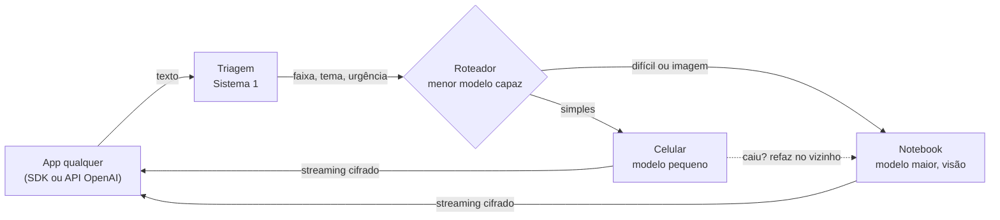

<p align="center">
  <picture>
    <source media="(prefers-color-scheme: dark)" srcset="docs/brand/logo-dark.svg">
    
  </picture>
</p>
<p align="center"><b>Protocolo aberto de inferência local e distribuída em hardware comum</b><br>
100% offline · API compatível com OpenAI · cifrado e assinado em cada etapa</p>

---

LORIS transforma aparelhos que você já tem, como um celular antigo e um notebook, numa rede de IA que roda **sem internet**. Um roteador olha cada pergunta, decide quanto de modelo ela precisa e manda para o **menor modelo capaz** da rede. Tudo viaja em envelopes cifrados e assinados.

> Apresentado no **DevFest Triângulo 2026** (31/10/2026).

## Por que

Quem depende de um provedor de IA herda dois riscos:

- **Disponibilidade:** o serviço sai do ar, muda de preço ou é suspenso, e a sua aplicação para junto.
- **Estabilidade:** o modelo por trás da API muda sem aviso, e o comportamento que você validou deixa de valer.

LORIS responde aos dois com uma ideia simples: **o provedor externo vira a sala**. Os modelos rodam nos aparelhos do próprio ambiente, cada um com versão congelada e verificável, atrás da mesma API que a sua aplicação já usa.

## O que o protocolo garante

| | Afirmação | Como |
|---|---|---|
| 1 | **Funciona sem internet** | Nós na rede local (Wi-Fi) e por perto (Bluetooth). Nada é resolvido fora da LAN em tempo de execução. |
| 2 | **Modelo congelado e verificável** | Cada modelo publica o `digest` (SHA-256 dos pesos) no cartão assinado do nó. |
| 3 | **A complexidade decide o modelo** | Triagem em faixas (R, C0 a C3) e seleção do menor nó capaz, com failover por heartbeat. |
| 4 | **Integração por padrão aberto** | Gateway `/v1/chat/completions` compatível com OpenAI: troca-se só o `base_url`. |
| 5 | **Seguro em cada etapa** | Cartão do nó assinado (Ed25519), pergunta e resposta cifradas ponta a ponta (HPKE), cada frame do streaming assinado. |

## Como uma pergunta anda



1. **Triagem (Sistema 1).** Um classificador pequeno ([Laya](https://www.npmjs.com/package/@receptron/laya), ModernBERT em ONNX) lê a pergunta e devolve uma ficha com probabilidades: complexidade, tema e urgência. Ele não escreve nada. Regras fixas corrigem a ficha (imagem exige modelo com visão; palavras de emergência marcam urgência) e assumem sozinhas se a triagem não responder.
2. **Seleção.** Entre os nós que atendem a faixa, o roteador escolhe o de menor capacidade suficiente e desempata por fila, velocidade e bateria. Se o escolhido para de mandar heartbeat, a tarefa é refeita em outro nó.
3. **Geração (Sistema 2).** O nó escolhido gera a resposta e devolve em streaming, frame a frame, cada um cifrado e assinado.

### Faixas

| Faixa | Significado |
|---|---|
| **R** | Recuperação resolve: busca numa base local; o modelo só redige a partir da ficha |
| **C0** | Geração curta |
| **C1** | Geração média (resumo, conversa) |
| **C2** | Multimodal ou domínio especializado |
| **C3** | Contexto longo ou raciocínio pesado |

## Segurança no protocolo, não no transporte

Cada mensagem é um envelope independente, o que funciona igual em HTTP e em Bluetooth e sobrevive a reconexões:

```json
{
  "v": "loris/0.1",
  "alg": "tink-hpke-x25519-chacha20poly1305+ed25519",
  "type": "task",
  "task_id": "0f3c…",
  "seq": 0,
  "from": "LORIS-AB12-CD34",
  "to": "LORIS-7K4P-QX2M",
  "ts": 1792937100123,
  "nonce": "…",
  "ct": "<HPKE para a chave do destinatário>",
  "sig": "<Ed25519 do remetente sobre cabeçalho + ct>"
}
```

- Criptografia só com **Google Tink** (mesma biblioteca em Kotlin e Python).
- O receptor valida, nesta ordem: fingerprint das chaves → assinatura → relógio (±300 s) → nonce inédito → só então decifra.
- Quem escuta a rede vê de quem, para quem e o tamanho. O conteúdo é ilegível, e alterar 1 byte invalida a assinatura.

**Limites, com honestidade:** o dono do nó decifra a pergunta para rodar o modelo; não há sigilo futuro (forward secrecy) em relação à chave estática do nó; metadados de presença são visíveis. Esconder o prompt do próprio nó exige TEE e atestação, e isso fica no roadmap.

## Endpoints

| Método | Caminho | O que faz |
|---|---|---|
| GET | `/loris/v0/card` | Cartão assinado do nó: modelos, digests, chaves, estado |
| POST | `/loris/v0/tasks` | Recebe um envelope `task`; responde `202` |
| GET | `/loris/v0/tasks/{id}/events` | SSE com envelopes `status`, `delta`, `result`, `error`; heartbeat de 1 s |
| POST | `/loris/v0/tasks/{id}/cancel` | Cancela a tarefa |
| POST | `/v1/chat/completions` | Gateway compatível com OpenAI (no roteador) |

## A demo

| Peça | Papel | Modelo |
|---|---|---|
| Celular Android antigo (Xiaomi, 8 GB) | Nó pequeno, app **Loris Node** como tela inicial | Gemma 4 E2B em CPU (LiteRT-LM) |
| Notebook (MacBook M1 Pro) | Roteador, gateway `/v1`, triagem e painel | Gemma 3 4B com visão (Ollama) |
| Qualquer celular | Cliente, app **Loris Chat** (assistente de saúde) | nenhum: usa a rede como motor |

O **Loris Chat** é "um app qualquer": não carrega modelo nenhum e usa o LORIS pelo SDK, do mesmo jeito que usaria uma API externa.

<p align="center">
  <a href="https://github.com/PabloBispo/loris-releases/releases/latest/download/loris-chat.apk"></a><br>
  <a href="https://github.com/PabloBispo/loris-releases/releases/latest/download/loris-chat.apk">Baixar o Loris Chat (APK Android)</a>
</p>

> Demo conceitual, feita para a palestra. Não é um produto e não substitui orientação de profissional de saúde.

## Fora de escopo

Nuvem, iOS, BLE, mesh, Kubernetes, contas de usuário. A ideia é provar o protocolo em hardware comum, não construir uma plataforma.

## Licença

[Apache-2.0](LICENSE)
